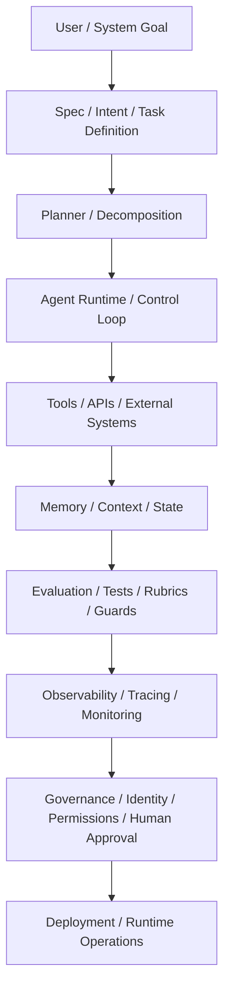
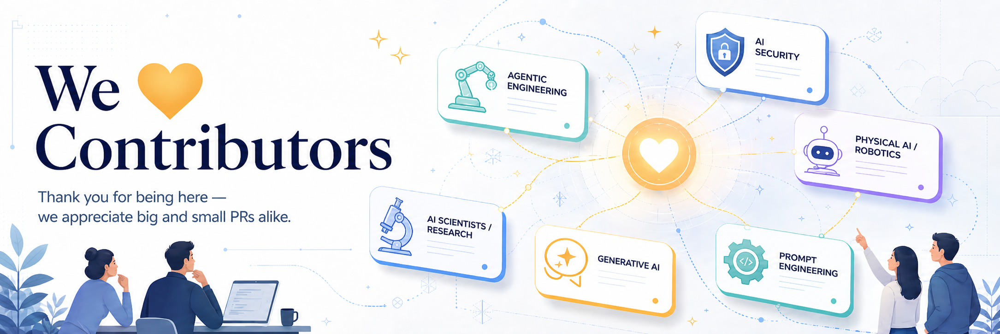

# 🧠 Awesome Agentic Engineering

> **Stop prompting. Start engineering. A structured reference for taking AI agents into production.**

   

A curated map of agentic AI systems — covering architectures, frameworks, memory, evaluation, and safety.

This is not a tool list. It's a structured guide to building **reliable, observable, production-grade agentic systems**, evaluated against rigorous engineering dimensions.

[Site source and publishing instructions](docs/README.md)

<h2 style="display:inline-block">🚀 Get Started</h2>

Audience: practitioners · Evidence class: mixed

Choose a core pattern (e.g. single-agent + tools) 
Add structured tool use 
Introduce evaluation early 
Layer in memory only when needed 
Expand into multi-agent systems with clear roles 
Add observability and safety constraints

---

## 📑 Table of Contents

- [🧭 Thesis](#-thesis)
- [🧱 Agentic Engineering Reference Stack](#-agentic-engineering-reference-stack)
- [⚖️ Architecture Decision Guide](#architecture-decision-guide)
- [🧩 Core Agentic Patterns](#-core-agentic-patterns)
- [🏗️ Reference Architectures](#reference-architectures)
- [📐 Spec-Driven Development](#-spec-driven-development)
- [🧠 Memory Systems](#-memory-systems)
- [📊 Formal Evaluation Rubric](#-formal-evaluation-rubric)
- [Benchmark and Evidence Policy](#benchmark-and-evidence-policy)
- [⚙️ Orchestration Frameworks](#orchestration-frameworks)
- [📡 Protocols and Standards](#-protocols-and-standards)
- [🛂 Agent Authority, Identity & Delegation](#-agent-authority-identity--delegation)
- [🧭 Reasoning & Planning Models](#-reasoning--planning-models)
- [🧪 Evaluation & Safety](#-evaluation--safety)
- [🧠 Skills and Operating Principles](#-skills-and-operating-principles)
- [🚫 What NOT to Do](#-what-not-to-do)
- [📊 Signals (How to Read This List)](#-signals-how-to-read-this-list)
- [Related Projects](#related-projects)
- [🤝 Contributing](#-contributing)
- [🌟 Contributors](#-contributors)

### 📂 Appendix

- [🧱 Agentic Engineering Reference Stack](appendix/agentic-engineering-reference-stack.md)
- [🌐 Browser and Desktop Agents](appendix/browser-and-desktop-agents.md)
- [🎙 Voice Agents](appendix/voice-agents.md)
- [🎨 Creative AI](appendix/creative-ai.md)
- [💼 Customer Support and CRM Agents](appendix/customer-support-and-crm-agents.md)
- [🧠 Open-Source Models for Agents](appendix/open-source-models-for-agents.md)
- [📰 Newsletters and Communities](appendix/newsletters-and-communities.md)
- [📚 Learning Resources](appendix/learning-resources.md)
- [⚡ Fast-Moving Product Lists](appendix/fast-moving-product-lists.md)

---

## 🧭 Thesis

> Audience: all contributors · Evidence class: mixed

| 📈 The Shift (Agentic systems are moving to) | 📉 The Challenge (Implementations suffer from) | 🎯 Our Focus (This repository prioritises) |
| :--- | :--- | :--- |
| • Stateful, multi-step reasoning • Multi-agent collaboration & orchestration • Feedback-driven learning loops • Tool-augmented execution environments | • Fragility under iteration • Poor observability & evaluation • Weak memory & context management • Limited safety & governance | • **Reliability** over novelty • **Evaluation** over intuition • **Architecture** over tooling • **Systems thinking** over prompt engineering |

---

## 🧱 Agentic Engineering Reference Stack

> Audience: practitioners · Evidence class: mixed

A serious agentic system has nine engineering layers between a user goal and a running production system. Most production failures are a missing layer, not a bad model.

| Tier | Layers | What the tier is for |
| :--- | :--- | :--- |
| **Intent and execution** | Spec · Planner · Agent Runtime | Define what the system should do and how it does it. |
| **World-binding** | Tools · Memory · Evaluation | Connect the system to data, history, and ground truth. |
| **Operability** | Observability · Governance · Deployment | Keep it inspectable, accountable, and operable. |

Skip a tier and the layers above it become indefensible.

→ Full reference, with per-layer engineering concerns and failure modes: **[Agentic Engineering Reference Stack](appendix/agentic-engineering-reference-stack.md)**.

---

## ⚖️ Architecture Decision Guide

> Audience: practitioners · Evidence class: mixed

| If your task is... | Start with... | Escalate to... | Avoid... |
| :--- | :--- | :--- | :--- |
| **bounded, tool-using, low-risk** | single-agent + tools | typed state, retries | multi-agent teams |
| **long-running, inspectable, enterprise** | graph/workflow orchestration | approval gates, persistence | opaque emergent loops |
| **open-ended research** | planner/executor or supervisor | critique loops, memory | rigid pipelines only |
| **high-reliability extraction** | prompt chains + strict schemas | validator feedback loops | unconstrained conversational agents |
| **complex parallel execution** | modular multi-agent setups | shared workspace/memory | treating LLMs as deterministic |

> **Authority rule:** any agent that can act outside its own runtime — for example by calling APIs, modifying files, opening pull requests, sending messages, triggering workflows, or accessing private data — needs an explicit identity, scoped authority, audit trail, and revocation path. See [Agent Authority, Identity & Delegation](#-agent-authority-identity--delegation).

---

## 🧩 Core Agentic Patterns

> Audience: practitioners · Evidence class: mixed

These patterns underpin most production-grade agentic systems.

| Pattern | Description | Key Characteristic |
| :--- | :--- | :--- |
| **Single-Agent + Tool Use** | One reasoning loop with structured tool invocation | Suited to focused tasks with bounded scope |
| **Supervisor / Router Agents** | Central agent delegates tasks to specialised agents | Enables modularity and scalability |
| **Multi-Agent Collaboration** | Agents operate in parallel or sequence | Patterns: debate, critique, planning/execution split |
| **Reflection / Critique Loops** | Agents evaluate and refine their own outputs | Improves reliability over multiple iterations |
| **Retrieval-Augmented Agents** | External knowledge via vector search or APIs | Reduces hallucination and improves grounding |
| **Event-Driven / Long-Running Agents** | Persistent agents reacting to triggers over time | Requires memory, state, and orchestration |

---

## 🏗️ Reference Architectures

> Audience: practitioners · Evidence class: mixed

Representative system designs for real-world use.

- [DeerFlow](https://github.com/bytedance/deer-flow): Open-source orchestration system combining sub-agents, memory, and sandboxes; demonstrates workflow-oriented orchestration across agents with shared execution context. *Emerging.*
- [SWE-agent](https://github.com/SWE-agent/SWE-agent): Autonomous software-engineering system using a specialised Agent-Computer Interface (ACI); demonstrates narrow action spaces and interface design tuned for code-repair tasks. *Experimental.*
- [Proxifield](https://arxiv.org/abs/2609.20889): Multi-agent communication protocol with sparse semantic routing; demonstrates proposal, peer-reply, and action-commitment rounds, studied on simulated drone search-and-rescue and HiddenBench collective reasoning. *Research preprint.* `[official]` `[benchmark]`

---

## 📐 Spec-Driven Development

> Audience: practitioners · Evidence class: mixed

*Last reviewed: November 2026 (Matt Pocock Skills, Awesome DESIGN.md and Harness² entries, list reformat); other entries: September 2026.*

Agentic systems amplify whatever intent you feed them — including vague intent. **Spec-driven development (SDD)** treats the specification as the load-bearing artifact: a durable, reviewable document that describes *what* the system should do and *how* it should behave, from which plans, code, and tests are generated (and regenerated) by agents. It is the production-grade answer to "vibe coding."

In an agentic context, the spec does three things at once:

1. **Anchors intent** — a typed, versioned contract the agent (and humans) refer back to across long sessions.
2. **Defines the acceptance surface** — plans, tasks, and tests are derived from the spec, not improvised per prompt.
3. **Makes re-generation safe** — regenerating code from an updated spec is cheaper and more reviewable than patching drift.

### Core practices

| Practice | What it means | Why it matters for agents |
| :--- | :--- | :--- |
| **Spec before plan before code** | Write a scoped spec (problem, constraints, acceptance criteria) before any plan or implementation. Plans and code are generated *from* the spec. | Agents behave better against a fixed target than against a shifting prompt. |
| **Executable specs** | Encode acceptance criteria as runnable checks (tests, evals, schema validators) alongside prose. | Lets agents self-verify and lets CI reject regressions without human review on every step. |
| **Typed contracts at boundaries** | Specify tool signatures, state shape, and I/O schemas with types (Pydantic, JSON Schema, TypeSpec). | Narrows the action space the agent can hallucinate into. |
| **Review the spec, not the diff** | Human review focuses on the spec and acceptance checks; the diff is a consequence. | Makes agent-authored PRs tractable at volume. |
| **Versioned and diffable** | Specs live in the repo, are PR-reviewed, and evolve with the code. | Gives rollback, blame, and audit trail — same hygiene as code. |
| **One spec, many artifacts** | Generate plans, tasks, tests, and docs from the same spec. | Keeps planner, actor, and verifier aligned. |

### Resources

Evidence tags follow the [Benchmark and Evidence Policy](#benchmark-and-evidence-policy).

- [GitHub Spec Kit](https://github.com/github/spec-kit): Open-source toolkit for spec-driven development with agentic coding assistants (Copilot, Claude Code, Cursor, Gemini CLI). Defines the `/specify` → `/plan` → `/tasks` → `/implement` workflow used in this repo's own `specs/` directory. `[official]` [announce](https://github.blog/ai-and-ml/generative-ai/spec-driven-development-with-ai-get-started-with-a-new-open-source-toolkit/)
- [Kiro](https://kiro.dev): AWS IDE built around spec-driven development: specs, steering files, and hooks drive agent work from requirements through tasks. First-party reference implementation of SDD in an IDE. `[official]` [docs](https://kiro.dev/docs/) · `[official]` [launch post](https://kiro.dev/blog/introducing-kiro/)
- [OpenAI Model Spec](https://model-spec.openai.com/): First-party example of treating *model behaviour* as a versioned, public spec — objectives, rules, defaults, and conflict resolution. A reference for how to write a spec an agent can actually be aligned to. `[official]` [post](https://openai.com/index/sharing-the-latest-model-spec/)
- [AGENTS.md](https://agents.md/): Simple convention for a repository-scoped file that instructs coding agents about build, test, style, and conventions. Widely supported across agent CLIs. `[official]`
- [Anthropic Claude Skills (SKILL.md)](https://www.claude.com/skills): Declarative, self-contained skill specs (`SKILL.md`) that package instructions, tools, and examples agents can discover and load on demand. Treats individual capabilities as versioned spec artifacts. `[official]` [docs](https://docs.claude.com/en/docs/agents-and-tools/agent-skills/overview)
- [Harness Handbook](https://arxiv.org/abs/2607.13285): Paper proposing behaviour-centric maps from agent-harness behaviours to source locations, with progressive disclosure for planning edits across evolving harness codebases. `[benchmark]`
- [Repo0](https://arxiv.org/abs/2608.19854): Paper proposing full-repository generation from natural-language requirements with architecture as an explicit intermediate state: a Dual-DAG aligns requirement and component graphs, evolves module boundaries under modularity metrics until convergence, then drives test-driven implementation. `[benchmark]`
- [Harness²](https://github.com/google-research/harness2): Research framework that refines an agent's harness (prompts, tools, memory, skills, subagents) per task and keeps a persistent improvement harness, with model weights fixed. Supports OpenCode and Codex executors; model-backed runs need Google Cloud configuration. Not an officially supported Google product. `[official]` [paper](https://arxiv.org/abs/2610.14224)
- [Pydantic AI](https://ai.pydantic.dev/): Python framework that makes schema-first I/O the default for LLM calls — the practical form of "typed contracts at boundaries" for agent code. `[official]`
- [Matt Pocock Skills](https://github.com/mattpocock/skills): Open-source collection of `SKILL.md` engineering skills (for example `tdd`, `to-spec`, `code-review` and `grill-me`) that install into Claude Code, Codex, Copilot, Gemini CLI and other agent CLIs. Worked example of encoding engineering workflow discipline as reusable skill specs. `[official]`
- [Awesome DESIGN.md](https://github.com/VoltAgent/awesome-design-md): Curated collection of `DESIGN.md` files, each describing a brand's design system (for example Stripe, Linear and Vercel) in a form coding agents read before generating UI. Extends the repository-file spec pattern of `AGENTS.md` to visual design. `[official]`

### Where SDD applies

SDD is not limited to new projects or a single team. The spec becomes a portable artifact in three directions:

| Context | How SDD applies | Notes |
| :--- | :--- | :--- |
| **Greenfield projects** | Write the spec first; agents scaffold the repo, tests, and initial implementation from it. | Easiest case — no legacy constraints; the spec defines the system boundary. |
| **Brownfield projects** | Reverse-engineer specs from existing code and behaviour, then use them as the contract for future agent-authored changes. | Start narrow (one module or flow), treat the spec as the accepted behaviour, and expand coverage incrementally. Agents modify against the spec, not the full legacy codebase. |
| **Shared across orgs** | Specs, prompts, evals, and skill packs (`SKILL.md`, `AGENTS.md`, prompt libraries) are repo-level artifacts that can be open-sourced, forked, and re-used — like shared test suites or style guides. | Treat prompts and evals as first-class, versioned assets; publish them alongside code so research, patterns, and hard-won lessons compound across teams rather than staying trapped in one org. |

> **How this repo uses SDD:** the local-only `specs/` directory contains phased specs (requirements → plan → validation) generated and executed against with Spec Kit. The `tasks/todo.md`, phase validation scripts, and PR bodies are derived artifacts. See [CONTRIBUTING.md](CONTRIBUTING.md) for the contributor-facing workflow.

---

## 🧠 Memory Systems

> Audience: practitioners · Evidence class: mixed

*Last reviewed: November 2026 (list reformat); Hyperconsciousness entry: September 2026; other entries: April 2026.*

Memory is a first-class concern in agentic systems. Rather than treating memory as a simple array of previous messages, production systems require structured approaches to state, persistence, retrieval, and **experience reuse**. Four categories — working, episodic, procedural, semantic — remain the core architectural choices, but recent frontier research also shows memory is increasingly being used to **improve future agent behaviour**, not merely to store past context.

### Memory Taxonomy

Different types of memory serve distinct functional roles in an agentic architecture:

| Type | Definition | Implementation Examples |
| :--- | :--- | :--- |
| **Working Memory** (Thread State) | Short-term context for the current execution loop or active conversation thread. Ephemeral. | Context window, LangGraph `State`, in-memory message lists. |
| **Episodic Memory** | Autobiographical history of past actions, inputs, and outcomes. Enables reflection on past mistakes. | Checkpoint logs, event stores, prompt / trajectory histories. |
| **Procedural Memory** | Reusable skills, system prompts, and tool configurations. Defines *how* the agent operates. | Static configuration, retrieved skill libraries, GitHub workflows. |
| **Semantic Memory** | Embedded, factual knowledge about the world, the user, or the domain. Defines *what* the agent knows. | Vector databases (FAISS, Pinecone), knowledge graphs, Letta core memory. |

### Frontier Research: Memory Beyond Storage

Recent research shows frontier agent systems moving beyond simple retrieval towards **experience transformation**: converting prior trajectories, workflows, and reasoning patterns into reusable guidance for future tasks. Memory becomes part of the learning loop, not just the context pipeline.

- [Agent Workflow Memory (AWM)](https://github.com/zorazrw/agent-workflow-memory): Episodic and procedural memory that induces reusable workflows from prior experience and selectively retrieves them to guide future generations; improves long-horizon web-agent tasks in both offline and online settings. `[official]` · `[benchmark]` [paper](https://arxiv.org/abs/2409.07429)
- [Synapse](https://ltzheng.github.io/Synapse/): Episodic memory that stores exemplar trajectories and retrieves them via similarity search, using complete state–action histories (not shallow few-shot examples) to improve multi-step computer control. `[official]` · `[benchmark]` [paper](https://arxiv.org/abs/2306.07863)
- [ReasoningBank](https://arxiv.org/abs/2509.25140): Episodic and procedural memory that distils generalisable reasoning strategies from self-judged successful *and* failed experiences, then retrieves and updates them over time so the agent improves through continued interaction. `[benchmark]`

### Architectural Patterns: Shared vs. Private Memory

In multi-agent systems, memory boundaries are architectural decisions:

- **Private Agent Memory**: Each agent maintains its own semantic and episodic stores. Prevents context leakage and maintains strong role boundaries.
- **Shared Workspace (Global Memory)**: A common blackboard or shared state where multiple agents read and write. Requires collision management and strict typing.

### Retrieval and Persistence Decisions

Managing the memory lifecycle is critical for long-running agents.

| Mechanism | Description | Best Practices & Risks |
| :--- | :--- | :--- |
| **Checkpointing** | Saving the exact thread state at a specific point in time (e.g., node transitions). | Enables "time travel" (rewind and replay) and human-in-the-loop approvals. |
| **Write Policies** | Rules defining when and how an agent commits data to long-term storage. | Prefer explicit `SaveMemory` tool calls over passive auto-saving to maintain control. |
| **Retrieval Triggers** | Determining when to query past memory (e.g., pre-fetch vs. just-in-time). | Use vector search for semantic recall, but use explicit graph keys for structured state. |
| **Summarisation / Compression** | Reducing token counts of episodic histories. | Summarise older interactions into a rolling summary while preserving recent exact messages. |
| **Pruning / Decay** | Deleting or archiving old or irrelevant memories. | Implement TTL (time-to-live) for working memory to prevent context exhaustion. |
| **Contamination / Poisoning** | Malicious or incorrect data persisting in long-term memory. | **Risk**: Once poisoned, an agent's future logic breaks. Require validation or bounds on semantic writes. |

### Systems and Protocols

Specialised infrastructure for managing agent memory.

*Last reviewed: November 2026 (list reformat); Hermeneutic entry: September 2026.*

- [LangGraph Persistence](https://langchain-ai.github.io/langgraph/): Thread-level state. Built-in check-pointers (SQLite, Postgres) for DAG-based execution loops, enabling interrupt/resume.
- [LangMem](https://github.com/langchain-ai/langmem): Long-term memory extraction. LangChain's framework for extracting user preferences and entity profiles in the background.
- [Letta](https://github.com/letta-ai/letta): OS-level memory abstraction (formerly MemGPT). Advanced core memory management with explicit paging (read/write limits) to mimic virtual memory.
- [Mem0](https://github.com/mem0ai/mem0): Personalised memory layer. Managed memory API focusing on user contexts, interactions, and entity relationships.
- [Zep / Graphiti](https://github.com/getzep/graphiti): Enterprise memory and graphs. Fast, long-term memory for AI assistants; uses temporal knowledge graphs to map entity relationships over time.
- [MCP (Model Context Protocol)](https://modelcontextprotocol.io/): Interoperability fabric. While not a database itself, MCP provides a standard protocol to expose memory stores and file systems universally across tools and agents.
- [Hyperconsciousness](https://github.com/louis030195/hyperconsciousness): Encrypted knowledge store. Developer-alpha Rust store for append-only records, device sync and scoped, expiring MCP grants. Source installation; APIs may change. `[official]` [Security limits](https://github.com/louis030195/hyperconsciousness/blob/main/docs/CONSTRAINTS.md)
- [Hermeneutic](https://github.com/hermes-labs-ai/hermeneutic): Correction-derived episodic memory. Mines correction episodes from agent logs into a local corpus; retrieves relevant prior corrections as advisory context with corpus-row citations. Narrow correction patterns; retrieval requires local Ollama; downstream improvement unmeasured. `[official]` [memory workflow](https://github.com/hermes-labs-ai/hermeneutic#hermeneutic-memory) · `[benchmark]` [bounded retrieval evaluation](https://github.com/hermes-labs-ai/hermeneutic/blob/main/evals/leave-one-out/RESULTS.md)

> **Design implication:** the key question is no longer only *what* the agent remembers, but *how memory changes future behaviour*. Systems like Synapse, Agent Workflow Memory, and ReasoningBank signal a shift — memory is becoming part of the agent's learning loop, enabling reusable routines and self-improvement over time.

---

## 📊 Formal Evaluation Rubric

> Audience: maintainers · Evidence class: mixed
>
> **🎯 Evaluation principle:** rubrics assess quality, test suites verify behaviour, assertions enforce invariants, and LLM-as-a-judge is used only in tightly scoped regression tests.

Every major framework and architecture in this repository is judged against the following **Required Scoring Dimensions**. We evaluate systems based on engineering rigor, not marketing copy.

| Dimension | Evaluation Criteria |
| :--- | :--- |
| **Control flow explicitness** | How observable and deterministic is the execution path? |
| **State model** | How is agent state typed, managed, and persisted? |
| **Memory support** | Are there built-in primitives for short-term, episodic, and semantic memory? |
| **Observability / tracing** | Is it easy to trace intermediate reasoning steps and tool calls? |
| **Human-in-the-loop support** | Does it natively support interrupt-and-resume or approval gates? |
| **Type safety / structured outputs** | Are outputs guaranteed against strict schemas? |
| **Provider portability** | How tightly coupled is it to one specific LLM provider? |
| **Security posture** | Are there built-in mechanisms for sandboxing, access control, or guardrails? |
| **Architectural strengths** | Which design choices materially improve decomposition, control, state handling, or interface clarity? |
| **Operational constraints** | What deployment burden, runtime cost, debugging friction, or failure modes does it introduce? |
| **Ecosystem maturity** | How stable are the APIs, docs, integrations, and operator knowledge base? |
| **Governance fit** | Does it support auditability, approval gates, access boundaries, policy enforcement, and regulated environments? |
| **Workload suitability** | Which workflows, task shapes, and team contexts does it fit well or poorly? |

---

## Benchmark and Evidence Policy

> Audience: maintainers · Evidence class: official

Canonical resources are trusted here because they define what counts as evidence. Prefer official docs, architecture guides, papers, benchmark repos, and first-party repositories when establishing capabilities, methodology, or interface details.

| Evidence Tag | Use For |
| :--- | :--- |
| `[official]` | Official docs, architecture guides, specifications, benchmark documentation, or first-party repositories. |
| `[benchmark]` | Published benchmark runs, evaluation papers, or benchmark repos tied to a named workload. |
| `[field report]` | Production write-ups, incident reports, engineering blogs, or operator notes about real deployments. |
| `[author assessment]` | This repository's synthesis after reviewing the sources above and applying the rubric. |

- Do not treat marketing copy, launch-day demos, or GitHub stars as sufficient evidence for production claims.
- Separate benchmark performance from production maturity. A benchmark result can support workload fit, but it does not by itself prove reliability, governance fit, cost control, or operational maturity.
- Record `Last reviewed: Month YYYY` in rapidly changing sections such as product lists, vendor capability summaries, and release-sensitive guidance.
- See [appendix/benchmark-and-evidence-policy.md](appendix/benchmark-and-evidence-policy.md) for the full policy.

## ⚙️ Orchestration Frameworks

> Audience: practitioners · Evidence class: mixed

*Last reviewed: November 2026 (LazyMind review, link maintenance and list reformat).*

### Deep Dives

Evidence tags follow the [Benchmark and Evidence Policy](#benchmark-and-evidence-policy). Scored against [RUBRIC.md](RUBRIC.md); cap of 5–8 deep-dive entries enforced.

- [LangGraph](https://langchain-ai.github.io/langgraph/): Stateful orchestration framework building directed graphs with typed state; demonstrates deterministic execution control mixed with LLM reasoning. *Production-ready.* `[official]` · `[field report]` [LinkedIn SQL Bot](https://www.linkedin.com/blog/engineering/ai/practical-text-to-sql-for-data-analytics)
- [Microsoft Agent Framework](https://github.com/microsoft/agent-framework): Microsoft's unified agent framework merging Semantic Kernel and AutoGen, with first-class MCP and A2A support; demonstrates enterprise-grade agent composition with typed plugins, approval workflows, and Azure integration. *Production-ready.* `[official]` · `[official]` [announce](https://devblogs.microsoft.com/foundry/introducing-microsoft-agent-framework-the-open-source-engine-for-agentic-ai-apps/)
- [AutoGen](https://microsoft.github.io/autogen/): Microsoft Research multi-agent conversation framework, now an orchestration pattern inside Microsoft Agent Framework; demonstrates conversable agents with group chat, code-executor, and human-proxy patterns. *Production-ready.* `[official]` · `[benchmark]` [AutoGen paper](https://arxiv.org/abs/2308.08155)
- [OpenAI Agents SDK](https://openai.github.io/openai-agents-python/): OpenAI's official agents SDK with handoffs, guardrails, and sessions, and the successor path to the Assistants API; demonstrates first-party multi-step agents with tool use, tracing, and structured handoffs. *Production-ready.* `[official]` [repo](https://github.com/openai/openai-agents-python)
- [CrewAI](https://docs.crewai.com/): Multi-agent collaboration framework where agents are assigned roles, goals, and tools; demonstrates role-based agentic workflows with sequential and hierarchical processes. *Emerging.* `[official]` · `[field report]` [case studies](https://www.crewai.com/case-studies)
- [LazyMind](https://github.com/LazyAGI/LazyMind): Local-first runtime that turns reusable agent skills into observable workflows with editable, versioned artifacts; demonstrates skill-derived execution with review checkpoints and step-level recovery. Public evidence is currently first-party. *Emerging.* `[official]` · `[official]` [workflow format](https://github.com/LazyAGI/LazyMind/blob/9bea30bb4aaedc3a0a1759a7e9dc03f9704e9fb7/docs/workflow-format.md) · `[official]` [releases](https://github.com/LazyAGI/LazyMind/releases)
- [Pydantic AI](https://ai.pydantic.dev/): Framework built directly on Pydantic, enforcing strict data validation and type-safe outputs from LLMs; demonstrates type-driven agentic execution and dependency injection. *Production-ready.* `[official]`
- [Smolagents](https://huggingface.co/docs/smolagents): Minimalist framework using `CodeAgents` (Python logic code generation over JSON calling); demonstrates code-first model execution bounds. *Emerging.* `[official]`

---

### Frameworks Landscape

Broader catalog beyond the deep-dive set. Each subsection capped at 8 entries; entries that cannot clear the rubric were removed in this phase (see PR body for cut list).

#### General Purpose

- [LangChain](https://github.com/langchain-ai/langchain): Modular framework with chains, tools, memory, and broad integration coverage. Py/JS. `[official]`
- [LangGraph](https://github.com/langchain-ai/langgraph): Graph-based orchestration. Stateful typed-state graphs with checkpointing. Py/JS. `[official]`
- [LlamaIndex](https://github.com/run-llama/llama_index): Data-centric framework for retrieval-heavy and RAG-oriented agent systems. Py/JS. `[official]`
- [Haystack](https://github.com/deepset-ai/haystack): Pipeline-based framework for search, retrieval, and hybrid agent workflows. Py. `[official]`
- [Semantic Kernel](https://github.com/microsoft/semantic-kernel): Microsoft enterprise kernel; now a composable layer inside Microsoft Agent Framework. C#/Py/Java. `[official]`
- [Microsoft Agent Framework](https://github.com/microsoft/agent-framework): Microsoft's unified agent framework merging Semantic Kernel and AutoGen; first-class MCP and A2A support. Py/.NET. `[official]`
- [Pydantic AI](https://github.com/pydantic/pydantic-ai): Type-safe, Pydantic-native; schema-first LLM interactions with dependency injection. Py. `[official]`
- [DSPy](https://github.com/stanfordnlp/dspy): Stanford. Programming not prompting; compiler optimises prompts against metrics. Py. `[official]` · `[benchmark]`

#### Multi-Agent Orchestration

- [AutoGen](https://github.com/microsoft/autogen): Microsoft Research multi-agent conversations; v0.4 redesigned for async event-driven execution. Py. `[official]` · `[benchmark]`
- [CrewAI](https://github.com/crewAIInc/crewAI): Role-based crew members with goals, tools, and sequential/hierarchical processes. Py. `[official]`
- [OpenAI Agents SDK](https://github.com/openai/openai-agents-python): Official OpenAI multi-step agents with handoffs, guardrails, sessions, and tracing. Py. `[official]`
- [Google ADK](https://github.com/google/adk-python): Native Gemini multi-agent orchestration; deploys to Vertex AI Agent Engine. Py. `[official]`
- [MetaGPT](https://github.com/geekan/MetaGPT): PM / architect / engineer roles simulating a software company; research-oriented. Py. `[official]` · `[benchmark]`
- [CAMEL](https://github.com/camel-ai/camel): Role-based simulation and collaborative reasoning research framework. Py. `[official]` · `[benchmark]`
- [DeerFlow](https://github.com/bytedance/deer-flow): ByteDance orchestration system for planning, tools, memory, and execution. Py. `[official]`
- [AgentScope](https://github.com/modelscope/agentscope): Alibaba multi-agent framework with message-passing runtime and distributed mode. Py. `[official]`

#### Lightweight / Minimalist

- [Smolagents](https://github.com/huggingface/smolagents): HuggingFace minimal agents (~1000 lines); code-action agents with sandboxed execution. Py. `[official]`
- [Agno](https://github.com/agno-agi/agno): Lightweight, model-agnostic agent framework with native multi-modal support. Py. `[official]`
- [Upsonic](https://github.com/upsonic/upsonic): MCP-first framework with minimal setup and typed task graphs. Py. `[official]`
- [Mastra](https://github.com/mastra-ai/mastra): TypeScript-first framework with observability, workflows, and memory. TS. `[official]`

---

## 📡 Protocols and Standards

> Audience: practitioners · Evidence class: official

*Last reviewed: November 2026 (list reformat); link maintenance: September 2026.*

Protocols are the stable contracts between agents, tools, and hosts. Each entry below distinguishes the **specification** from any specific implementation — mixing the two is a repeat anti-pattern (see [ANTI-PATTERNS.md](ANTI-PATTERNS.md)).

- [MCP (Model Context Protocol)](https://modelcontextprotocol.io/): Open spec. Anthropic-authored open standard for exposing tools, resources, prompts, and sampling to LLM hosts; wide multi-vendor adoption in 2025–2026. `[official]` [spec](https://modelcontextprotocol.io/specification/)
- [A2A (Agent2Agent)](https://github.com/a2aproject/A2A): Open spec. Google-originated, Linux Foundation–hosted protocol for secure cross-agent communication across vendors and frameworks. `[official]` [spec](https://a2a-protocol.org/)
- [OpenAI Function / Tool Calling](https://platform.openai.com/docs/guides/function-calling): Vendor API. Native structured tool invocation for OpenAI models; JSON-schema-typed tool definitions. `[official]`
- [Anthropic Tool Use](https://docs.anthropic.com/en/docs/build-with-claude/tool-use): Vendor API. Native structured tool invocation for Claude models; supports parallel tool calls and computer-use tools. `[official]`
- [OpenAPI](https://github.com/OAI/OpenAPI-Specification): Open spec. Industry-standard HTTP API specification; foundation for typed, discoverable tool surfaces behind MCP or direct function-calling. `[official]`

---

## 🛂 Agent Authority, Identity & Delegation

> Audience: practitioners, AI security, enterprise architects · Evidence class: mixed

*Last reviewed: November 2026 (list reformat); other content: October 2026.*

Protocols like MCP, A2A, and function calling explain **how** agents connect to tools and systems. This section covers **who or what is authorised** to use those connections, and how that authority is governed in production — what the industry has begun to call the **AI Agent Authority Gap**.

Action-taking agents do not emerge with independent authority. They are triggered, invoked, provisioned, or empowered by existing enterprise identities — human users, service accounts, bots, machine identities, OAuth tokens, API keys, tool connectors, MCP servers, CLIs, scripts, and automation infrastructure. The same agent loop can reach into source control, ticketing, messaging, cloud APIs, and private data through credentials that were never designed for autonomous use.

> Agents are not just a new identity type. They are a **delegated identity type**. Their authority originates from traditional enterprise actors — humans, bots, service accounts, and machine identities — and is **inseparable from the posture of those delegators**.

Traditional IAM was built to answer a narrow question: *who has access?* Once agents are introduced, the operative question shifts:

> What authority is being delegated, by whom, under what conditions, for what purpose, and across what scope?

**Identity dark matter** is the term for authority that exists, operates, and accumulates risk **outside the view of managed IAM** — fragmented human and machine identities, embedded credentials, unmanaged service accounts, bot accounts, and application-specific identity logic. If that dark matter remains unobserved, agents inherit an already-broken authority model and become efficient amplifiers of hidden access, hidden permissions, and hidden execution paths.

The practical consequence is **sequencing**: an enterprise cannot safely govern Agent-AI unless it first observes and governs the traditional actors that serve as its **delegation source**. Closing the authority gap is therefore a delegation problem first, and an agent problem second.

### Core Concepts

| Concept | Definition | Why it matters |
|---------|------------|----------------|
| **Agent Identity** | A first-class, distinguishable identity for the agent itself, separate from the human, service account, or bot whose authority it borrows. | Without it, every agent action is attributed to its delegator or a shared service account, breaking attribution, audit, and incident response. |
| **Delegation Source** | The human, service account, bot, or machine identity that triggers, invokes, or empowers the agent. | Agent authority is inseparable from delegator posture; a poorly governed delegator yields a poorly governed agent. |
| **Delegation Chain** | The end-to-end path *delegator → agent → tool → target application → action*, including any intermediate scopes, tokens, and approvals. | Makes the path of authority explicit and reviewable instead of inherited from whatever credentials the runtime happens to hold. |
| **Identity Dark Matter** | Authority — identities, credentials, tokens, service accounts, embedded secrets, application-specific access paths — that exists and operates outside the view of managed IAM. | Agents amplify hidden authority into automated action at machine speed; un-illuminated dark matter becomes the agent's effective permission set. |
| **Authority Boundary** | The explicit set of applications, workflows, scopes, and actions an agent is allowed to touch. | Defines the blast radius. An agent without a stated boundary effectively has the union of every credential its delegator can reach. |
| **Dynamic Sequential Delegation Control** | Runtime authority decisions that combine the **posture** of the delegator, the **context** of the target application, the **intent** behind the requested action, and the **scope** of execution. | Static, long-lived permissions do not match agents whose delegators, tasks, and risk levels change per run. |
| **Continuous Observability** | A live feed of identity behaviour across managed and unmanaged environments, used as input to authority decisions rather than as after-the-fact reporting. | Turns observability into governance: the same telemetry that illuminates dark matter becomes the decision input for what the agent is allowed to do next. |
| **Human Approval Gate** | A required human checkpoint before sensitive or irreversible actions are executed. | Keeps high-impact decisions reviewable; separates *recommend* from *execute* on the act / recommend / constrain / stop continuum. |
| **Audit Trail** | An immutable record linking *delegator → agent identity → delegated authority → tool call → target application → decision point → result*. | Required for incident response, compliance, and learning loops. Without it, agent failures are unreproducible and dark matter stays dark. |
| **Revocation Path** | A defined, tested way to disable an agent, rotate its credentials, and invalidate its delegated authority — including upstream delegator credentials when needed. | When an agent or its delegator is compromised, you need a working off switch, not a code change. |

### Design Principles

- Treat agents as **delegated actors**, not autonomous islands; their authority is bounded by the posture of their delegation source.
- **Govern the delegation source first.** Reduce identity dark matter across human and machine identities before granting agents broad action rights.
- Map the delegation chain explicitly: *delegator (human / service account / bot / machine identity) → agent → tool → target application → action*.
- Use least privilege, scoped tokens, short-lived credentials, and tested revocation paths at every link in the chain.
- Govern authority continuously on **posture, context, intent, and scope** — not only on nominal permissions issued at provisioning time.
- Operate agents on an **act / recommend / constrain / stop** continuum: not every request should result in execution; some should be downgraded to recommendation, restricted to a limited tool set, or blocked.
- Separate **recommend**, **prepare**, **execute**, and **approve** as distinct steps in the agent loop, and require human approval gates for sensitive or irreversible actions (writes to production, financial transactions, external messages, code merges).
- Log the **delegator, agent identity, delegated authority, tool call, target application, decision point, and result** for every action — not just the final answer.
- Evaluate whether agents attempt to **exceed their authority** or **amplify dark matter**, not only whether they complete tasks.
- Do not confuse model guardrails with identity governance. Production systems need both: prompt-level safety *and* continuous, IAM-level delegation control.

### Resources

- [Bridging the AI Agent Authority Gap](https://thehackernews.com/2026/04/bridging-ai-agent-authority-gap.html): Frames AI agents as a delegated identity type whose authority originates from humans, bots, service accounts, and machine identities, and argues for governing the delegation source before the agent.
- [OWASP GenAI Security Project](https://genai.owasp.org/): Governance and threat-modelling reference for agentic systems, including excessive agency and tool-use risks.
- [Model Context Protocol](https://modelcontextprotocol.io/): Tool and context protocol. Tool access expands the authority surface of agentic systems; MCP is a primary vector for that expansion and where scoping must be applied.
- [Auth0 AI Agents / Token Vault](https://auth0.com/ai): Practical identity pattern for managing agent access to user-authorised systems with short-lived, scoped tokens.
- [NVIDIA OpenShell](https://github.com/NVIDIA/OpenShell): Out-of-process runtime policy enforcement for agent sandboxes. Enforces declarative YAML policy outside the agent process, with Landlock filesystem confinement fixed at sandbox creation, network egress policy that can be updated on a running sandbox, and process restrictions; pre-1.0, see the [docs](https://docs.nvidia.com/openshell/latest/about/why-open-shell).

---

## 🧭 Reasoning & Planning Models

> Audience: researchers · Evidence class: benchmark

*Last reviewed: November 2026 (list reformat); other content: July 2026.*

Models that do **explicit reasoning or planning at inference time** — chain-of-thought baked into the decoding loop, extended thinking budgets, or trained planner heads. They change the shape of agent loops: the model absorbs work that used to live in a planner node, which shifts where you spend tokens, latency, and trust. Cap of 5–8 entries; selected for agentic relevance, not general benchmark wins. Same-family tiers (e.g. `mini` / `nano`, Sonnet / Haiku, Flash / Flash-Lite) are grouped into one row because they share the same reasoning interface and differ mainly in latency and cost.

- [GPT-5.4 (`gpt-5.4` / `mini` / `nano`)](https://developers.openai.com/api/docs/models/gpt-5.4): OpenAI. Tunable reasoning effort with native computer-use, web/file search, and function tools; one family covers planner, subagent/actor, and high-volume tool-calling tiers. `[official]` [model index](https://developers.openai.com/api/docs/models) · [`mini`](https://developers.openai.com/api/docs/models/gpt-5.4-mini) · [`nano`](https://developers.openai.com/api/docs/models/gpt-5.4-nano)
- [Claude Opus 4.7 / Sonnet 4.6 / Haiku 4.5](https://www.anthropic.com/system-cards): Anthropic. Configurable extended-thinking budget interleaved with tool calls; the same dial across a planner/worker/fast-actor trio. `[official]` [extended thinking](https://docs.anthropic.com/en/docs/build-with-claude/extended-thinking)
- [Gemini 3.1 Pro / 3 Flash / 3.1 Flash-Lite](https://deepmind.google/models/model-cards/): Google DeepMind. Deep Think parallel-hypothesis reasoning (Pro) and a thinking-capable Flash tier; a three-tier reasoning ladder over a long-context stack. `[official]` [Gemini 3.1 Pro card](https://deepmind.google/models/gemini/)
- [DeepSeek-R1](https://github.com/deepseek-ai/DeepSeek-R1): DeepSeek. RL-trained reasoning traces with open weights; a reproducible baseline for planner research and local agent stacks. `[official]` · `[benchmark]` [paper](https://arxiv.org/abs/2501.12948)
- [Qwen3 (thinking mode)](https://github.com/QwenLM/Qwen3): Alibaba. Open-weight family with switchable thinking and non-thinking modes, usable in both planner and actor roles. `[official]` · `[benchmark]` [tech report](https://arxiv.org/abs/2505.09388)
- [Grok 4](https://x.ai/news/grok-4): xAI. Native reasoning with tool use; a diversity source in multi-model planner ensembles. `[official]`
- [Multi-Head Latent Control](https://arxiv.org/search/?query=Multi-Head+Latent+Control%3A+A+Unified+Interface+for+LLM+Agent+Decision+Making&searchtype=title): Huawei. Dedicated latent control heads select among answering, tool use, clarification, abstention, and delegation; useful for studying where policy, escalation, and safe refusal sit in agent loops. `[benchmark]`

> Decision guide: if your agent loop already does explicit plan → act → verify steps, a reasoning model can often **replace** the planner node — but it rarely removes the need for typed state, tracing, and eval. Treat reasoning as a cheaper planner, not a free reliability upgrade.

---

## 🧪 Evaluation & Safety

> Audience: researchers · Evidence class: benchmark

*Last reviewed: November 2026 (Cloudflare security-audit skill entry, list reformat); other entries: October 2026.*

This section covers frameworks and operational tooling for testing agent quality, correctness, task completion, regressions, and system behaviour, as well as security scanning, red teaming, policy testing, and misalignment research. Evidence tags follow the [Benchmark and Evidence Policy](#benchmark-and-evidence-policy).

### Core Evaluation Areas

- Output correctness  
- Reasoning quality  
- Tool-use accuracy  
- Latency and cost  
- Robustness under adversarial input  

### Evaluation Frameworks

- [OpenAI Evals](https://github.com/openai/evals): Core framework for testing and improving AI systems; foundational evaluation framework and methodology. `[official]`
- [DeepEval](https://deepeval.com/docs/getting-started): Open-source LLM evaluation framework with metrics for hallucination, answer relevance, and task completion; suited to application-level evaluation and regression testing. `[official]`
- [promptfoo](https://www.promptfoo.dev/docs/intro/): CLI and library for evaluation and red teaming of LLM apps; suited to regression testing, prompt/application evals, and adversarial testing. `[official]`
- [Inspect](https://inspect.aisi.org.uk/): UK AI Security Institute's framework for rigorous LLM evals covering coding, reasoning, agent behaviour, and model-graded scoring; suited to research-grade and agent-task evaluation. `[official]` · `[benchmark]`
- [Azure AI Evaluation SDK](https://learn.microsoft.com/en-us/azure/ai-foundry/concepts/evaluation-approach-gen-ai): Azure Foundry evaluation SDK with built-in agent, safety, and quality evaluators; suited to enterprise agent evaluation tied to Foundry tracing. `[official]`
- [ai-evaluation](https://github.com/future-agi/ai-evaluation): Open-source LLM evaluation framework with 50+ metrics, LLM-as-Judge, and guardrail scanners (jailbreak, PII, injection). `[official]`
- [agent-opt](https://github.com/future-agi/agent-opt): Prompt and agent optimisation library with six algorithms (Bayesian, ProTeGi, GEPA, and more) for iterative tuning across eval datasets. `[official]`
- [simulate-sdk](https://github.com/future-agi/simulate-sdk): Persona- and scenario-driven SDK for simulating voice and text AI agents; suited to pre-production simulation and stress testing. `[official]`

### Key Practices

- Golden datasets  
- Regression testing  
- Adversarial / red-team inputs  
- Continuous evaluation pipelines  

### Tracing and Monitoring

- [Langfuse](https://github.com/langfuse/langfuse): OSS LLM observability. Traces, evals, prompts.
- [LangSmith](https://smith.langchain.com): LangChain platform. Tracing, testing, evaluation.
- [Braintrust](https://braintrustdata.com): Eval-driven development. Experiment tracking.
- [Arize Phoenix](https://github.com/Arize-ai/phoenix): OSS AI observability. Traces, evals, embeddings.
- [Helicone](https://github.com/Helicone/helicone): OSS LLM observability. One-line integration.
- [Weights and Biases Weave](https://wandb.ai/site/weave): Trace and evaluate LLM apps.
- [traceAI](https://github.com/future-agi/traceAI): OpenTelemetry-native tracing for LLM and agent apps with 50+ framework integrations.
- [agenttrace](https://github.com/luoyuctl/agenttrace): Local-first TUI and report generator for auditing AI coding-agent session logs, token and cost usage, latency, tool failures, health, and CI regression checks.
- [Future AGI](https://github.com/future-agi/future-agi): Self-hostable end-to-end agent engineering platform with tracing, evals, guardrails, and gateway.
- [OrcaReplay](https://github.com/Continuum-AI-Corp/OrcaReplay): Records a coding-agent run below the harness, then replays it offline with no model called or forks it from a checkpoint onto another model.

### Benchmarks

- [SWE-bench](https://github.com/princeton-nlp/SWE-bench): Coding-agent benchmark grounded in real GitHub issues and patches; `Verified` subset is the canonical agent workload. `[official]` · `[benchmark]`
- [AgentBench](https://github.com/THUDM/AgentBench): 8-environment LLM agent benchmark covering OS, DB, web, and game tasks. `[official]` · `[benchmark]`
- [Terminal-Bench](https://terminalbench.com): Evaluates terminal-agent execution on shell-based tasks with scored task completions. `[official]` · `[benchmark]`
- [GAIA](https://huggingface.co/gaia-benchmark): General AI assistant benchmark with real-world multi-step tasks and tool use. `[official]` · `[benchmark]`
- [WebArena / VisualWebArena](https://github.com/web-arena-x/webarena): Web agent benchmark on real-website snapshots; visual variant tests multimodal web agents. `[official]` · `[benchmark]`
- [τ-bench](https://github.com/sierra-research/tau-bench): Tool-use + user-simulation benchmark measuring agent reliability and consistency across trials. `[official]` · `[benchmark]`
- [LLMs Get Lost in Evolving User Intent](https://github.com/microsoft/evolving-intent): Evaluates whether models track changing user intent across multi-turn conversations with argument reveals, revisions, function switches, and combined transitions; supports GSM8K, BIRD-SQL, BrowseComp+, and SWE-bench Verified. `[official]` · `[benchmark]` [paper](https://arxiv.org/abs/2607.20734)
- [OSWorld](https://github.com/xlang-ai/OSWorld): Computer-use benchmark for multimodal agents on real desktop OS tasks across Ubuntu/Windows/macOS; complements web-only benchmarks. `[official]` · `[benchmark]` [paper](https://arxiv.org/abs/2404.07972)
- [LiveCodeBench](https://livecodebench.github.io): Contamination-resistant coding benchmark with time-stamped problems from LeetCode/AtCoder/Codeforces; complements SWE-bench's repo-issue workload. `[official]` · `[benchmark]` [paper](https://arxiv.org/abs/2403.07974)
- [WebVoyager](https://github.com/MinorJerry/WebVoyager): Web-agent benchmark on live production websites (not snapshots); tests multimodal browsing under real network and UI drift conditions. `[official]` · `[benchmark]` [paper](https://arxiv.org/abs/2401.13919)
- [ClawBench](https://github.com/TIGER-AI-Lab/ClawBench): Browser-agent benchmark on live production websites with isolated runs, final-request interception, and five-layer execution evidence. `[official]` · `[benchmark]` [paper](https://arxiv.org/abs/2604.08523)
- [DataPrep-Bench](https://datapreparationbench.github.io/): Evaluates LLMs and agents on automated training-data preparation workflows, adding a data-centric workload for comparing multi-stage preparation capabilities beyond conventional task-execution benchmarks. `[official]` · `[benchmark]` [paper](https://arxiv.org/abs/2607.20465)
- [YYLO Benchmark](https://github.com/yylo-dev/yylo-benchmark): Longitudinal evaluation and immutable evidence for agent runs: private fresh-repository attempt workspaces, deterministic and LLM-judge evaluation profiles, and hash-linked receipts, manifests, and evaluator provenance. `[official]` · `[benchmark]`
- [AgentWorld](https://github.com/openagents-org/agentworld): Long-horizon multi-agent collaboration benchmark in an MMORPG sandbox: 100 human-annotated tasks plus augmented variants for 3–20 role-differentiated agents, Python success verifiers, and a causal-graph metric (CCE) measuring the share of actions that contributed to task success. `[official]` · `[benchmark]` [paper](https://arxiv.org/abs/2609.31590)
- [PerspectiveGap](https://github.com/WhymustIhaveaname/PerspectiveGap): Multi-agent orchestration prompting benchmark: 110 scenarios over 10 loop topologies test whether a model gives each sub-agent the context fragments it needs and writes role prompts without omissions or cross-role leakage, scored by a deterministic strict-pass check. `[official]` · `[benchmark]` [paper](https://arxiv.org/abs/2606.08878)
- [From Prompts to Posteriors](https://arxiv.org/abs/2610.29331): Tests whether LLM agents update beliefs as Bayes' rule prescribes; in-context updating is mostly poor, while reasoning plus code execution approaches the correct posterior. `[benchmark]`

### Safety Risk Surfaces & Mitigations

| ⚠️ Core Risk Surfaces | 🛡️ Mitigation Strategies |
| :--- | :--- |
| Prompt injection (direct & indirect) | Input validation and filtering |
| Tool misuse | Tool permissioning and sandboxing |
| Data exfiltration | Human-in-the-loop approval gates |
| Memory poisoning | Audit logs and traceability |
| Unbounded autonomous behaviour | Policy-driven execution |

### Safety Tooling & Methodologies

- [garak](https://github.com/NVIDIA/garak): LLM vulnerability scanner probing for hallucination, leakage, injection, toxicity, and jailbreaks.
- [OWASP GenAI Security Project](https://genai.owasp.org/): Governance and mitigation framework for safety risks in LLMs and agentic systems.
- [Anthropic Alignment Stress-Testing](https://www.alignmentforum.org/posts/EPDSdXr8YbsDkgsDG/introducing-alignment-stress-testing-at-anthropic): Research and operational approach for deliberately stress-testing alignment evals and oversight.
- [Model Organisms of Misalignment](https://www.alignmentforum.org/posts/ChDH335ckdvpxXaXX/model-organisms-of-misalignment-the-case-for-a-new-pillar-of-1): In-vitro demonstrations of alignment failures so they can be studied empirically.
- [AI Safety via Debate](https://arxiv.org/abs/1805.00899): Alignment framework for cases where direct human supervision is too hard.
- [Concrete Problems in AI Safety](https://arxiv.org/abs/1606.06565): Foundational framing paper for safety problems (side effects, reward hacking, safe exploration, shift).
- [Anthropic Agentic Misalignment](https://www.anthropic.com/research/agentic-misalignment): Grounds safety concerns in concrete behaviours (blackmail, espionage) in simulated settings.
- [Cloudflare security-audit skill](https://www.skills.sh/cloudflare/security-audit-skill): Agent skill for security audits, listed under the `cloudflare` namespace and installed with `npx skills add cloudflare/security-audit-skill`.

### AI Guardrails

- [Guardrails AI](https://github.com/guardrails-ai/guardrails): Structural, type, quality guarantees for LLM outputs.
- [NeMo Guardrails](https://github.com/NVIDIA/NeMo-Guardrails): NVIDIA. Programmable conversation guardrails.
- [LLM Guard](https://github.com/protectai/llm-guard): Security toolkit. Input/output scanning.
- [Rebuff](https://github.com/protectai/rebuff): Prompt injection detection.
- [Lakera Guard](https://lakera.ai): Real-time protection. Prompt injection, data leakage, toxicity.

---

## 🧠 Skills and Operating Principles

> Audience: practitioners · Evidence class: field report

Building agentic systems requires a shift in skillset:

- Problem decomposition  
- System design and orchestration  
- Tool and interface design  
- Memory modelling  
- Evaluation design  
- Failure mode analysis  
- Safety and governance thinking  

---

## 🚫 What NOT to Do

> Audience: all contributors · Evidence class: mixed

To keep this repository genuinely opinionated, we advocate against these common anti-patterns:

- **Do not begin with multi-agent systems when a single agent plus tools will do.** Escalate to multi-agent only when task decomposition requires it.
- **Do not add memory before defining what deserves persistence.** Avoid "state bloat" by being intentional about what is stored and why.
- **Do not treat tracing as optional for long-running systems.** Observability is the only way to debug non-deterministic agentic failures.
- **Do not confuse benchmark wins with production readiness.** Real-world reliability requires evaluation on *your* specific data and edge cases.
- **Do not use framework abstractions as a substitute for architecture.** Understand your control flow before outsourcing it to a library.
- **Do not give agents inherited or ambient authority without mapping the delegation chain.** Every action-taking agent should have a clear identity, scoped permissions, observable tool calls, approval gates where needed, and a revocation path. See [Agent Authority, Identity & Delegation](#-agent-authority-identity--delegation).

---

## 📊 Signals (How to Read This List)

> Audience: all contributors · Evidence class: mixed

- ⭐ Production-grade  
- 🧪 Experimental  
- ⚠️ Early-stage / unstable  
- 🛂 Authority-aware — explicitly models identity, delegated permissions, approval gates, and auditability  

---

## Related Projects

Companion field guides by the same maintainer covering adjacent areas of AI. Read alongside this repository for broader context on how agentic AI is being built and applied beyond the security boundary.

- [Awesome Physical AI](https://github.com/natnew/Awesome-Physical-AI) — Robotics, embodied AI, and physical-world agent systems.
- [Awesome Agentic AI Security](https://github.com/natnew/Awesome-Agentic-AI-Security) — Security research, threat models, defenses, and governance for agentic AI systems.
- [Awesome AI Scientists](https://github.com/natnew/Awesome-AI-Scientists) — AI scientist systems for literature intelligence, hypothesis generation, experiment planning, tool use, evaluation, and scientific communication.

---

## 🤝 Contributing

Thrilled to have you here. 
Whether it's a quick typo fix, a fresh resource, 
a doc polish, or a sweeping overhaul — every contribution helps this list grow. 
Jump in and join the community — PRs of every size are welcome.

📝 [Read the contributing guide](CONTRIBUTING.md) · 🐛 [good first issues](https://github.com/natnew/Awesome-Agentic-Engineering/issues?q=is%3Aissue+is%3Aopen+label%3A%22good+first+issue%22)

<a href="appendix/benchmark-and-evidence-policy.md">
  <picture>
    <source media="(prefers-color-scheme: dark)" srcset="assets/github/evidence-policy-dark.svg">
    
  </picture>
</a>

---

## 🌟 Contributors

Thank you to everyone who has added a resource to this list. 📚 marks a contributed resource; select it to see what was added.

<table>
  <tr>
    <td align="center" width="33%">
      <a href="https://github.com/SuhaniNagpal7"> <b>Suhani Nagpal</b></a> 
      <a href="https://github.com/natnew/Awesome-Agentic-Engineering/commit/cd9bd1dfd96decfde7a87c40c5892a66e5eedf5d" title="Added Future AGI products to Evaluation, Tracing &amp; Monitoring, and AI Guardrails">📚</a>
    </td>
    <td align="center" width="33%">
      <a href="https://github.com/reacher-z"> <b>reacher-z</b></a> 
      <a href="https://github.com/natnew/Awesome-Agentic-Engineering/pull/28" title="Added ClawBench to agent benchmarks">📚</a>
    </td>
    <td align="center" width="33%">
      <a href="https://github.com/InsightFactoryAPP"> <b>InsightFactoryAPP</b></a> 
      <a href="https://github.com/natnew/Awesome-Agentic-Engineering/pull/34" title="Added YYLO Benchmark to Evaluation &amp; Safety benchmarks">📚</a>
    </td>
  </tr>
  <tr>
    <td align="center" width="33%">
      <a href="https://github.com/xizhuomengcontin"> <b>xizhuomengcontin</b></a> 
      <a href="https://github.com/natnew/Awesome-Agentic-Engineering/pull/36" title="Added OrcaReplay to Tracing and Monitoring">📚</a>
    </td>
    <td align="center" width="33%">
      <a href="https://github.com/roli-lpci"> <b>Roli Bosch</b></a> 
      <a href="https://github.com/natnew/Awesome-Agentic-Engineering/pull/38" title="Added Hermeneutic to Memory Systems">📚</a>
    </td>
    <td align="center" width="33%">
      <a href="https://github.com/louis030195"> <b>Louis Beaumont</b></a> 
      <a href="https://github.com/natnew/Awesome-Agentic-Engineering/pull/39" title="Added Hyperconsciousness to Memory Systems">📚</a>
    </td>
  </tr>
  <tr>
    <td align="center" width="33%">
      <a href="https://github.com/WhymustIhaveaname"> <b>WhymustIhaveaname</b></a> 
      <a href="https://github.com/natnew/Awesome-Agentic-Engineering/pull/48" title="Added PerspectiveGap to Evaluation &amp; Safety benchmarks">📚</a>
    </td>
    <td align="center" width="33%">
      <a href="https://github.com/pranshuchittora"> <b>pranshuchittora</b></a> 
      <a href="https://github.com/natnew/Awesome-Agentic-Engineering/pull/51" title="Added agent-qa to Browser and Desktop Agents">📚</a>
    </td>
    <td align="center" width="33%">
      <a href="https://github.com/NicoYang1984"> <b>NicoYang1984</b></a> 
      <a href="https://github.com/natnew/Awesome-Agentic-Engineering/pull/52" title="Added LazyMind to Orchestration Frameworks">📚</a>
    </td>
  </tr>
</table>

Add a resource and your profile picture lands here. See the [contributing guide](CONTRIBUTING.md) to get started.

